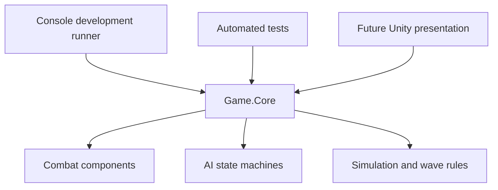

# 🧱 Architecture

[← Home](../README.md) · [Roadmap](ROADMAP.md)

## Headless-first C# architecture



**Core:** Health, attack, target selection, AI transitions, wave logic, simulation ticks. No dependency on `UnityEngine`.

**Console:** Run gameplay scenarios and inspect logs without launching Unity.

**Tests:** Verify combat behavior and edge cases. Keep time and randomness controllable.

**Unity:** Later adapt the core model to GameObjects, visuals, animation, sound, and input. Physics and engine-dependent behavior still require Unity testing.

## Principles

1. One authoritative source of truth for each value, especially health and damage.
2. Favor composition for reusable capabilities and inheritance for clear, stable is-a relationships.
3. Use events to *announce* changes, not to hide essential game-rule mutations.
4. Keep interfaces small and dependencies explicit.
5. Build the simplest correct system before optimizing.
6. Check Unity's supported C# and API compatibility before configuring production target frameworks.

## Planned directory structure

```text
src/Game.Core/       # Pure C# simulation
src/Game.Console/    # Headless runner
tests/Game.Tests/    # Automated tests
docs/                # Learning plan and architecture
```

These are design targets. Existing local `_04_Component` exercises will be migrated and refactored rather than silently replaced.

## Platform and multiplayer boundaries
Target dependency direction: Unity/Console → Application → Core; platform adapters implement narrow application contracts. The composition root wires local or Steam services. Core must not reference Steam or Unity. Shared gameplay commands represent intentions from AI, strategy, first-person and third-person input; authority validates and applies them. Stable IDs, versioned saves and separate presentation state support future replication. See [decisions](DECISIONS.md) and [Steam readiness](STEAM.md). Game.Core currently targets net10.0; verify Unity compatibility before changing it.
